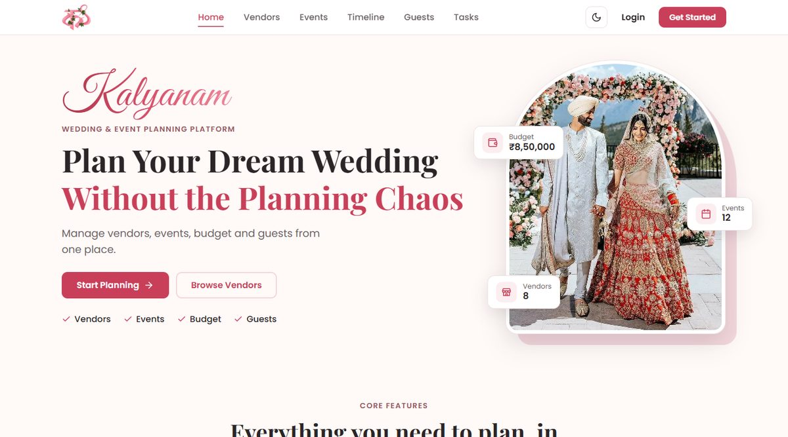
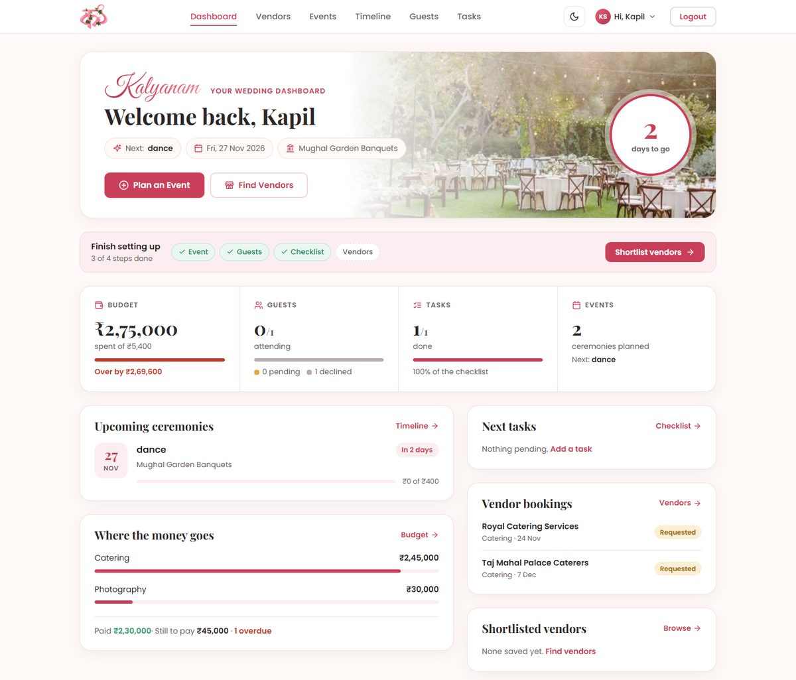
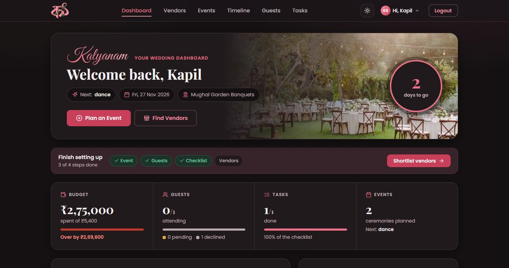

# Kalyanam – Wedding & Event Planning Management Platform

**Kalyanam** (a word that means "wedding" and "auspicious") is a web app for planning
a wedding from start to finish: find and book vendors, plan every ceremony, track the
budget and payments, manage the guest list, send invitation cards on WhatsApp, and
follow a task checklist.

GLA University, B.Tech CSE 3rd Year mini project, **Group 7**. Mentor: **Yash Singh**.


| | |
|---|---|
| **Live website** | https://kalyanam-ashen.vercel.app |
| **Live API (JSON Server)** | https://kalyanam-api.onrender.com |
| **Demo account** | email `123@gmail.com`, password `123` |

> The API runs on a free server that sleeps after 15 minutes without visitors.
> If the site shows no data, open https://kalyanam-api.onrender.com/vendors once,
> wait until the list appears (up to a minute), then reload the website.



## Team

| Member | GitHub | Module | Branch | Folder |
|---|---|---|---|---|
| Kapil Singh (Team Lead) | [@Kapilsingh001](https://github.com/Kapilsingh001) | Project setup, homepage, user dashboard, tasks, wedding timeline, profile card, loading animation, dark mode, shared UI kit, routing, GitHub and deployment | `feature/frontend` | `src/components`, `src/pages` |
| Hemant Varshney | [@Hemant284](https://github.com/Hemant284) | Vendor directory, vendor detail page, shortlist, booking requests | `feature/vendors` | `src/features/vendors` |
| Jatin Kumar | [@jatin110105](https://github.com/jatin110105) | Events and ceremonies, expenses, budget charts, payment tracking | `feature/planning` | `src/features/planning` |
| Kanishk Chahar | [@Kanishkchahar](https://github.com/Kanishkchahar) | Register, login, protected routes, guest list, digital invitations | `feature/auth` | `src/features/auth`, `src/features/guests` |

## Features

### Accounts (Kanishk)
- Register, login and logout, with form checks (Zod + React Hook Form)
- The logged-in user is kept in Redux Toolkit and `localStorage`
- Protected pages: a visitor who is not logged in is sent to the login page

### Vendors (Hemant)
- 15 vendors across 19 cities and 5 categories
- Search, filters (city, category, budget, rating), sorting, 8 vendors per page
- Vendor detail page with similar vendors
- Shortlist with a heart button and a "My Shortlist" bar
- Booking requests: pick a date and send a message; see and cancel them in "My booking requests"

### Events and budget (Jatin)
- Create, edit and delete events; each user sees only their own events
- Indian ceremonies: Haldi, Mehendi, Sangeet, Engagement, Wedding, Reception and more
- Expenses per event; spent and remaining budget calculated
- Planned budget for 8 categories, a pie chart and a Planned vs Actual bar chart (Recharts)
- Payments: paid or pending, due dates, overdue warnings and "Mark paid"
- A styled confirm pop-up before anything is deleted

### Guests and invitations (Kanishk)
- Guest list with RSVP status, search, filter and counts
- A wedding invitation card for each guest, made as a PNG picture
- Share the card on WhatsApp as a picture, with the invitation text and a link
- Invitation page for the guest (no login needed) to answer Attending, Cannot Attend or Maybe

### Dashboard, tasks, timeline and design (Kapil)
- Full-screen loading animation: the logo is drawn line by line and the name is written letter by letter, also at every login
- Personal dashboard: countdown to the next ceremony, budget, guests, tasks, where the money goes, vendor bookings and shortlisted vendors
- Task checklist with due dates (no dates in the past), suggested wedding tasks and overdue labels
- Wedding timeline: every ceremony in date order, grouped by month
- Profile card with photo upload and editable details
- Clickable invitation links on WhatsApp, and a short message from a guest who cannot attend
- Dark and light mode, remembered between visits
- Shared UI kit, custom dropdown and date picker, 404 page, works on phones



## Tech stack

| Part | Choice |
|---|---|
| UI | React 19 with Vite |
| Routing | React Router DOM v7 |
| State | Redux Toolkit (logged-in user) |
| Forms and checks | React Hook Form + Zod |
| API calls | Axios (one shared client in `src/services/api.js`) |
| Charts | Recharts |
| Styling | Plain CSS with CSS variables, light and dark themes |
| Data | `db.json` served as a REST API by JSON Server |
| Tests | Vitest + jsdom (140 tests) |
| Hosting | Vercel (website) and Render (JSON Server API) |

## Run it on your computer

```bash
git clone https://github.com/Kapilsingh001/wedding-event-planner.git
cd wedding-event-planner
npm install
```

**Quick start:** on Windows, double-click `start.bat`. On Linux or Mac, run `sh start.sh`.
This starts the API and the website together.

Or start them by hand, in two terminals inside the project folder:

```bash
npx json-server db.json --port 3001    # terminal 1: the database API
npm run dev                            # terminal 2: the website
```

Open http://localhost:5173 and log in with the demo account.

| Command | What it does |
|---|---|
| `npm test` | Runs all 140 tests (on Windows, use PowerShell) |
| `npm run build` | Builds the website into the `dist` folder |
| `npm run lint` | Checks the code with oxlint |

The website reads the API address from `VITE_API_URL` and uses `http://localhost:3001`
when it is not set. Copy `.env.example` to `.env` to change it.

## Deployment

| Part | Where | Settings |
|---|---|---|
| Website | Vercel, from the `main` branch | Preset **Vite**; environment variable `VITE_API_URL=https://kalyanam-api.onrender.com` |
| API | Render (free web service), from the `main` branch | Build `npm install`; start `npx json-server db.json --port $PORT --host 0.0.0.0` |

- Every merge into `main` updates both the website and the API.
- `vercel.json` sends every address to `index.html`, so refreshing any page works.
- `VITE_API_URL` is built into the website, so after changing it, redeploy on Vercel.
- Limits of the free API: it sleeps when idle, and data added on the live site is lost
  when the server restarts. JSON Server has no real security, so only demo accounts
  should be used on the live site.



## Project structure

```
index.html                loading screen (shows before React loads), page title, link preview
public/                   logo, drawn logo and name (SVG), loading screen styles, pictures
src/
  main.jsx                starts the app: theme, Redux store, loading screen
  App.jsx                 routes for every page
  index.css, ui.css       colours, fonts, shared UI kit
  dark.css, theme.js      dark mode
  splash.js               hides the loading screen and plays it again at login
  services/               api.js (Axios client), siteUrl.js (invitation link address)
  components/             Navbar, Footer, ProfileCard, Dropdown, DatePicker, Icons, home/
  pages/                  Dashboard, UserDashboard, Tasks, Timeline, NotFound
  features/
    auth/                 Login, Register, ProtectedRoute, Redux slice and store
    vendors/              Vendors, VendorDetail, shortlist, BookingForm, MyBookings
    planning/             Events, EventDetail, forms, budget charts, ConfirmDialog
    guests/               Guests, InviteModal, invitation card, PublicInvite
db.json                   users, cities, categories, vendors, events, expenses,
                          guests, tasks, bookings
docs/screenshots/         pictures used in this README
```

Each page keeps its calculations in a small helper file (for example `budgetUtils.js`,
`vendorUtils.js`, `dashboardUtils.js`), with a test file next to it (`*.test.js`).

## Git workflow

```
feature/* --Pull Request--> dev --Pull Request (team lead)--> main --> Vercel + Render
```

| Branch | Purpose |
|---|---|
| `main` | The released version; the live website is built from it |
| `dev` | Integration branch; every feature Pull Request is merged here first |
| `feature/*` | One branch per member |

### Every day

```bash
git switch feature/<your-branch>
git pull origin dev
# ...work...
git add <your files>
git commit -m "Describe what you did"
git push origin feature/<your-branch>
```

Then open a Pull Request from `feature/<your-branch>` into **`dev`**. The team lead
reviews and merges it, and later merges `dev` into `main` to update the live site.

## Team rules

1. Pull Requests from a feature branch always go to `dev`, never straight to `main`.
2. Only the team lead merges `dev` into `main`.
3. Every member commits their own work from their own GitHub account.
4. Pull the latest `dev` before starting new work.
5. Do not commit test data in `db.json`. Run `git restore db.json` after testing.
6. Do not commit `.env` files, passwords or API keys.

## Timeline

| Date | Milestone |
|---|---|
| 14-15 Sep 2026 | Project setup, branches and team folders |
| 23 Sep 2026 | Phase 1 review: homepage, vendors, events, login |
| 27-28 Oct 2026 | Phase 2 (60%): vendor detail, shortlist, edit and delete, charts, guest list, dark mode, tasks |
| 18-23 Nov 2026 | Final phase: Redux, Zod, tests, dashboard, timeline, bookings, payments, invitations, profile, Kalyanam branding |
| 23 Nov 2026 | Final presentation |
| 25 Nov 2026 | Merged into `main` and deployed on Vercel and Render |
